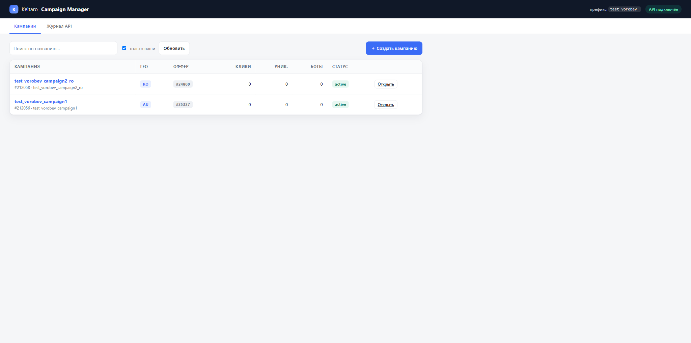
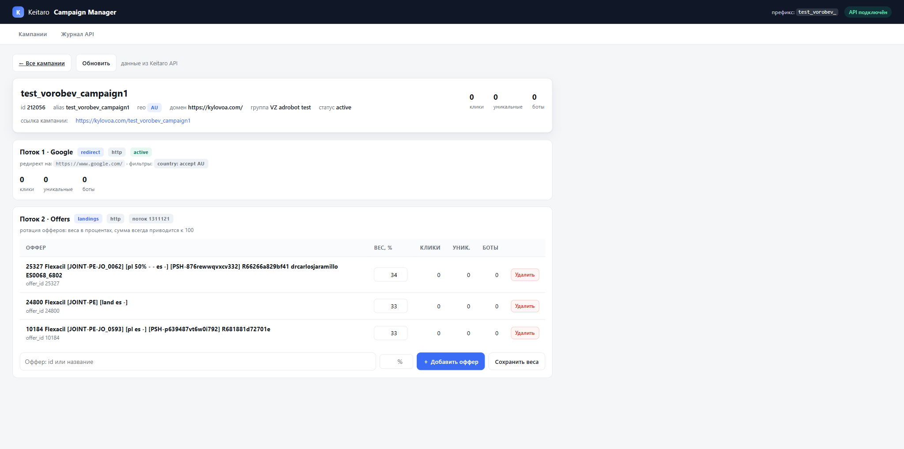
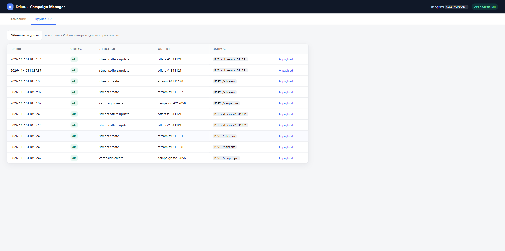

# Keitaro Campaign Manager

Веб-обёртка над **Keitaro Admin API v1**: создание трекинг-кампаний «в один клик» и редактор офферов
для уже существующих кампаний. Тестовое задание для позиции Fullstack (Python/Node.js).

Что умеет:

1. **Создание кампании** — принимает название, гео-код страны и ID оффера, а на стороне Keitaro создаёт
   кампанию и **два потока**:
   * поток №1 «Google» — ловит **всех посетителей из указанной страны** (фильтр `country` = `accept`) и
     редиректит на `https://www.google.com/` (`schema: redirect`, `action_type: http`, задан `action_options.url`);
   * поток №2 «Offers» — отдаёт выбранному офферу 100 % трафика (`schema: landings`, `offers[]`).
   Домен, группа кампаний и источник трафика тоже проставляются через API.
2. **Редактор офферов существующей кампании** — добавить / удалить оффер, поменять веса (share),
   с валидацией суммы в 100 % и с показом реальных цифр (клики / уникальные / боты) из Keitaro.

Название кампании автоматически получает префикс `test_vorobev_` (по ТЗ — `test_<фамилия>_`),
alias для URL генерируется транслитом: `campaign1` → `test_vorobev_campaign1`.

---

## Скриншоты

Список кампаний (данные — из Keitaro API, цифры — из `/report/build`):



Форма создания (оффер — автокомплит по справочнику Keitaro, гео — ISO-коды):


Карточка кампании: поток «Google» с фильтром по гео и URL редиректа, поток «Offers» с весами и статистикой:



Журнал обращений к API (аудит: что именно уходило в Keitaro и что вернулось):



---

## Стек

| Слой | Технологии |
|---|---|
| Backend | Python 3.10+, FastAPI, httpx (клиент Keitaro), SQLAlchemy 2.0, Alembic |
| БД | SQLite по умолчанию, любой другой URL через `DATABASE_URL` (Postgres и т.п.) |
| Frontend | Jinja2 + vanilla JS/CSS (без сборки), SPA-роутинг по hash |
| Тесты | pytest, фейковый клиент Keitaro (без сети) |

---

## Быстрый старт

```bash
# 1. зависимости
python -m venv .venv
source .venv/bin/activate          # Windows: .venv\Scripts\activate
pip install -r requirements.txt

# 2. настройки: скопировать шаблон и вписать свой API-ключ
cp .env.example .env
# KEITARO_API_KEY=<ключ из Keitaro: Профиль → API ключи>

# 3. миграции
alembic upgrade head

# 4. запуск
python run.py                     # http://127.0.0.1:8000, автоперезагрузка включена
# альтернатива без run.py:
# python -m uvicorn app.main:app --reload --port 8000
```

Открыть <http://127.0.0.1:8000>. Swagger со всеми эндпоинтами: <http://127.0.0.1:8000/docs>.

> Запускайте интерпретатором из `.venv` (или после `activate`). Если взять глобальный Python
> с несовместимым starlette, FastAPI падает на импорте с
> `TypeError: Router.__init__() got an unexpected keyword argument 'on_startup'` —
> `python run.py` такую ситуацию заранее диагностирует и подсказывает команду.

### Переменные окружения (`.env`)

| Переменная | Назначение | Значение по умолчанию |
|---|---|---|
| `KEITARO_BASE_URL` | база Admin API | `https://tlgk.host/admin_api/v1` |
| `KEITARO_API_KEY` | ключ API Keitaro | — (обязателен) |
| `CAMPAIGN_PREFIX` | префикс названий кампаний | `test_vorobev_` |
| `GOOGLE_URL` | куда редиректит поток №1 | `https://www.google.com/` |
| `DEFAULT_DOMAIN_ID` | домен по умолчанию | `1813` (`kylovoa.com`) |
| `DEFAULT_GROUP_ID` | группа по умолчанию | `9799` (`VZ adrobot test`) |
| `DEFAULT_TRAFFIC_SOURCE_ID` | источник по умолчанию | `836` (`FORTESTS`) |
| `DATABASE_URL` | подключение к БД | `sqlite:///./keitaro_wrapper.sqlite3` |
| `DICTIONARY_TTL_SECONDS` | TTL кэша справочников | `600` |

> `.env` в git не попадает (см. `.gitignore`) — ключ API это секрет.

---

## Миграции

Схема БД полностью описывается Alembic (`alembic/versions/0001_initial.py`):

```bash
alembic upgrade head      # применить
alembic downgrade -1      # откатить последнюю
alembic current           # текущая ревизия
alembic revision --autogenerate -m "..."   # новая миграция после правки моделей
```

`alembic/env.py` берёт URL из `app.config.settings`, поэтому `alembic.ini` править не нужно —
достаточно `DATABASE_URL` в `.env`.

### Зачем БД, если источник истины — Keitaro

| Таблица | Содержимое |
|---|---|
| `campaigns` | зеркало кампаний, созданных через сервис (id Keitaro, имя, alias, гео, оффер, домен/группа/источник, ссылка) |
| `campaign_flows` | снимок потоков кампании (`schema`, `action_type`, целевой URL, фильтры, позиция) |
| `flow_offers` | снимок офферов потока с весами |
| `operation_log` | журнал всех вызовов Keitaro: метод, путь, тело запроса/ответа, статус, текст ошибки |
| `dictionary_items` | кэш справочников (офферы, домены, группы, источники) — чтобы автокомплит не дёргал API |

Практический смысл: история изменений и аудит (видно, какой именно payload ушёл в Keitaro),
работа автокомплита без лишних запросов, и возможность показать список кампаний даже при недоступном API.
Зеркало пересинхронизируется при каждом открытии карточки кампании.

---

## HTTP API

| Метод | Путь | Описание |
|---|---|---|
| `GET` | `/api/config` | настройки UI (префикс, дефолтные id, статус подключения) |
| `GET` | `/api/dictionaries?refresh=1` | офферы / домены / группы / источники |
| `POST` | `/api/dictionaries` | создать группу или источник трафика (`{kind: "groups"\|"sources", name}`) |
| `GET` | `/api/campaigns?search=&only_ours=` | список кампаний + клики/уники/боты |
| `POST` | `/api/campaigns` | создать кампанию с двумя потоками |
| `GET` | `/api/campaigns/{id}` | карточка кампании: потоки, офферы, статистика |
| `PUT` | `/api/campaigns/{id}/flows/{stream_id}/offers` | заменить список офферов/веса |
| `POST` | `/api/campaigns/{id}/flows/{stream_id}/offers` | добавить оффер |
| `DELETE` | `/api/campaigns/{id}/flows/{stream_id}/offers/{offer_id}` | удалить оффер |
| `GET` | `/api/logs?limit=` | журнал операций |
| `GET` | `/api/statistics` | сводка по локальному зеркалу БД |
| `GET` | `/api/health` | статус приложения **и реальная проверка ключа** (`keitaro_ok`, `keitaro_error`, `api_key_hint`) |

Пример создания кампании:

```bash
curl -X POST http://127.0.0.1:8000/api/campaigns \
  -H 'Content-Type: application/json' \
  -d '{"name":"campaign1","geo":"AU","offer_id":25327}'
```

Если Keitaro отвечает `401 Invalid API key` — см. [docs/troubleshooting.md](docs/troubleshooting.md):
плашка в UI теперь показывает реальный статус ключа и красную полосу с текстом ошибки,
а `/api/health` отдаёт `api_key_hint` (последние 4 символа и длина), по которому видно, какой
именно ключ загружен — например, если в `.env` остался пример `put-your-api-key-here`.

Ответ — та же структура, что отдаёт `GET /api/campaigns/{id}`: `id`, `name`, `alias`, `url`, `geo`,
`flows[]` c `target_url`, `filters`, `offers[]`, `clicks/uniques/bots`.

---

## Как это работает внутри

```
app/
├── config.py       настройки (pydantic-settings, .env)
├── db.py           engine + session (SQLAlchemy 2.0)
├── models.py       таблицы (кампании, потоки, офферы, журнал, кэш справочников)
├── keitaro.py      клиент Admin API v1: ретраи не нужны, ошибки → KeitaroError с телом ответа
├── services.py     бизнес-логика (создание кампании, редактор офферов, статистика, журнал)
├── schemas.py      pydantic-схемы запросов
├── main.py         FastAPI-роуты + отдача UI
├── templates/      index.html (Jinja2)
└── static/         app.js, style.css
```

### Создание кампании (2 запроса на потоки + 1 на кампанию)

```http
POST /campaigns
{"name":"test_vorobev_campaign1","alias":"test_vorobev_campaign1","type":"position",
 "domain_id":1813,"group_id":9799,"traffic_source_id":836,"cost_type":"CPC","cost_value":0}

POST /streams
{"campaign_id":212056,"name":"Google","type":"regular","position":1,
 "schema":"redirect","action_type":"http",
 "action_options":{"url":"https://www.google.com/"},
 "filters":[{"name":"country","mode":"accept","payload":["AU"]}],
 "collect_clicks":true}

POST /streams
{"campaign_id":212056,"name":"Offers","type":"regular","position":2,
 "schema":"landings","action_type":"http","collect_clicks":true,
 "offers":[{"offer_id":25327,"share":100}]}
```

Важные детали:

* **`action_options.url` заполняется явно** — в этой сборке Keitaro `schema: redirect` без него
  бесполезен (у многих референсных кампаний в аккаунте он `null`).
* `type: "position"` — ротация «по позиции»: сначала поток №1 (он отсекает всех, кто не из нужной страны),
  остальной трафик доходит до потока №2.
* `collect_clicks: true` в обоих потоках, иначе `clicks`/`unique` в отчётах всегда 0.
* **Откат**: если создание компании/потоков падает, недособранная кампания удаляется
  (`DELETE /campaigns/{id}`), чтобы не мусорить в общем аккаунте. Тест на это есть.

### Редактор офферов

`PUT /streams/{id}` в Keitaro **перезаписывает массив `offers` целиком**, поэтому:

* «добавить оффер» = прочитать текущий поток (`GET /campaigns/{id}/streams`), дописать новый и отправить `PUT`;
* «удалить оффер» = то же самое минус один элемент;
* веса нормализуются к целым процентам с суммой ровно 100 (пропорционально введённым значениям,
  «крупнейший остаток»), новый оффер без веса забирает остаток, а если места нет — веса делятся поровну;
* менять офферы можно только в потоке со `schema: landings` (в нашем случае «Offers») — иначе 400;
* нельзя удалить последний оффер потока (Keitaro останется с пустым потоком) — тоже 400.

### Цифры в UI

У кампании нет статистики в `/campaigns`, поэтому используется `POST /report/build`:

```json
{"range":{"interval":"all_time"},
 "dimensions":["stream_id","offer_id"],
 "metrics":["clicks","campaign_unique_clicks","bots"],
 "filters":[{"name":"campaign_id","operator":"EQUALS","expression":212056}]}
```

`clicks` → «Клики», `campaign_unique_clicks` → «Уник.», `bots` → «Боты». Список кампаний
получает те же метрики одним запросом с `dimensions: ["campaign_id"]` (сопоставление по id надёжнее,
чем по имени — имена в общем аккаунте могут повторяться).

---

## Тесты

```bash
pytest -q      # 21 тест, сеть не нужен
```

Покрыто: создание кампании (префикс, alias, фильтр гео — в том числе несколько стран, `action_options.url`,
100 % офферу), откат при ошибке, зеркалирование в БД, нормализация весов, добавление/удаление оффера,
запрет дублей и удаления последнего оффера, запрет правки redirect-потока, валидация гео-кода и оффера,
цифры кампании/потоков/офферов из `/report/build`, флаг «создана здесь», повторное создание
с занятым именем (суффикс вместо ошибки), а также `/api/health` и подсказка при 401 (`tests/test_api.py`).

---

## Проверка «вживую»

Всё создавалось в реальном аккаунте Keitaro (`https://tlgk.host/admin`) собственным API-ключом:

| Кампания | id | Потоки |
|---|---|---|
| `test_vorobev_campaign1` | **212056** | Google: `redirect` → `https://www.google.com/`, фильтр `country accept ["AU"]`; Offers: 3 оффера (25327 / 24800 / 10184) |
| `test_vorobev_campaign2_ro` | **212058** | Google: `redirect` → `https://www.google.com/`, фильтр `country accept ["RO"]`; Offers: 24800 |

Сырые ответы API, снятые после создания, лежат в репозитории:
[`docs/campaign_212056.json`](docs/campaign_212056.json) и [`docs/streams_212056.json`](docs/streams_212056.json).
Подробный чек-лист проверки — в [docs/verification.md](docs/verification.md).

Цифры сверены с панелью на кампании с реальным трафиком (`test_walrus_campaign1`, id 209551):
поток «Offers» — 4 клика / 1 уник. / 3 бота, оффер `25327` — 2 / 1 / 1, и ровно то же отдаёт наш UI.
Мульти-гео (`AU, RO`) проверен на временной кампании и затем удалён.

Проверить самостоятельно:

```bash
curl -s -H "Api-Key: $KEITARO_API_KEY" \
  "https://tlgk.host/admin_api/v1/campaigns/212056/streams" | jq
```

Пробные кампании, созданные во время разведки API, удалены (`DELETE /campaigns/{id}` → 404 при проверке),
чтобы не засорять общий аккаунт.

---

## Ограничения и известные нюансы

* Домен `kylovoa.com` **не резолвится** из сети, где я работал, поэтому реальный клик по ссылке кампании
  не проверить: корректность проверена через API/панель Keitaro (структура потоков, фильтры, офферы, веса).
  Соответственно в статистике 0 кликов — это ожидаемо, а не баг UI.
* Домены из UI **только выбираются**: Keitaro требует подтверждения домена по DNS, добавление — ручной шаг в панели.
  Группу кампаний и источник трафика можно создать прямо из формы (кнопки «＋ создать»).
* `keitaro.py` не делает автоматических ретраев: для идемпотентных `GET` это было бы полезно,
  но `POST /campaigns` при повторе создаст дубль. Исключение — занятое имя: Keitaro отвечает
  `422 Alias/Name has already used`, в этом случае кампания один раз пересоздаётся с суффиксом
  (`test_vorobev_campaign1 b3f1` / alias `test_vorobev_campaign1-b3f1`), событие пишется в журнал
  как `campaign.create.duplicate_retry`. Так двойной клик по «Создать» не ломает форму.
* Ошибки валидации Keitaro (`400/401/403/404/422`) отдаются как `400` с текстом от Keitaro
  (чтобы было видно, что именно не так), `502` остаётся для сетевых сбоев и 5xx Keitaro.
* Список кампаний листается по всем страницам Admin API (`limit=300` + `offset`), поэтому поиск
  находит и старые кампании: в общем аккаунте их уже больше 300 (иначе кампании с offset > 300
  не попадали в поиск). Предохранитель — 10 страниц (`CAMPAIGNS_MAX_PAGES`). По умолчанию
  чужие «test»-кампании скрыты галочкой «только наши».

---

## Соответствие ТЗ

| Требование | Где реализовано |
|---|---|
| 「создаватор」 принимает название, гео-код, ID оффера | форма «＋ Создать кампанию», `POST /api/campaigns` |
| кампания с 2 потоками | `POST /streams` ×2: «Google» (`redirect`) и «Offers» (`landings`) |
| поток 1 — все из указанной страны → Google | фильтр `country accept [...]` + `action_options.url` |
| поток 2 — на выбранный оффер | `offers: [{offer_id, share: 100}]` |
| настроенные домен, группа, источник | `domain_id`, `group_id`, `traffic_source_id` в `POST /campaigns` |
| редактор существующей кампании: добавить/удалить оффер | карточка кампании: «＋ Добавить оффер», «Удалить», «Сохранить веса» |
| «кнопки работают, цифры верные» | Клики / Уник. / Боты на уровне кампании, потока и оффера — из `/report/build` |
| FastAPI + SQLAlchemy | `app/main.py`, `app/models.py`, `app/db.py`; фронт — HTML + vanilla JS |
| README для миграций и запуска | разделы «Быстрый старт», «Миграции», «Тесты» |

---

## Как использовались AI-агенты

Проект собран в паре с агентом (Cursor/Windsurf-подобный воркфлоу): агент разбирал OpenAPI-спеку Keitaro,
перебирал payload'ы на живом API (создание/удаление пробной кампании), генерировал код и тесты,
я проверял ответы API вручную и прогонял сценарии в браузере. Все секреты (API-ключ) — в `.env`,
в репозиторий не попадают.
