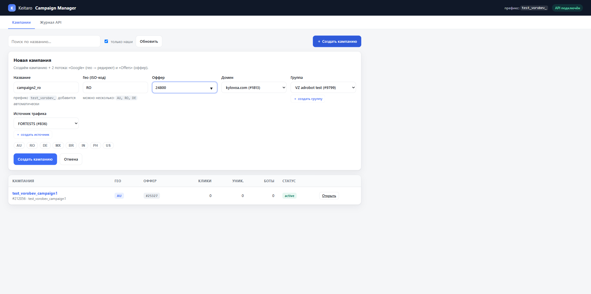

# Keitaro Campaign Manager

Веб-обёртка над **Keitaro**: создание трекинг-кампаний «в один клик» и редактор офферов
существующих кампаний.

1. **Создание кампании** — принимает название, гео-код и ID оффера, а в Keitaro создаёт кампанию и два потока:
   * «Google» — все посетители из указанной страны (`country` = `accept`) редиректятся на `https://www.google.com/`
     (`schema: redirect`, задан `action_options.url`);
   * «Offers» — выбранному офферу 100 % трафика (`schema: landings`, `offers[]`).
   Домен, группа и источник трафика тоже проставляются через API.
2. **Редактор офферов** — добавить / удалить оффер, поменять веса (share, сумма нормализуется к 100 %),
   с показом реальных цифр (клики / уникальные / боты) из Keitaro.

Название получает префикс `test_vorobev_`, alias — транслит: `campaign1` → `test_vorobev_campaign1`.

## Скриншоты

| Список кампаний | Форма создания |
|---|---|
|  |  |

| Карточка кампании | Журнал API |
|---|---|
|  |  |

## Стек

FastAPI + httpx + SQLAlchemy 2.0 + Alembic; SQLite по умолчанию (любой `DATABASE_URL`);
фронт — Jinja2 + vanilla JS/CSS без сборки.

## Быстрый старт

```bash
python -m venv .venv
source .venv/bin/activate          # Windows: .venv\Scripts\activate
pip install -r requirements.txt

cp .env.example .env               # вписать KEITARO_API_KEY (Профиль → API ключи)
alembic upgrade head
python run.py                      # http://127.0.0.1:8000, Swagger: /docs
```

| Переменная | Назначение | По умолчанию |
|---|---|---|
| `KEITARO_BASE_URL` | база Admin API | `https://tlgk.host/admin_api/v1` |
| `KEITARO_API_KEY` | ключ API Keitaro | — (обязателен) |
| `CAMPAIGN_PREFIX` | префикс названий | `test_vorobev_` |
| `GOOGLE_URL` | редирект потока №1 | `https://www.google.com/` |
| `DEFAULT_DOMAIN_ID` / `DEFAULT_GROUP_ID` / `DEFAULT_TRAFFIC_SOURCE_ID` | домен / группа / источник | `1813` / `9799` / `836` |
| `DATABASE_URL` | подключение к БД | `sqlite:///./keitaro_wrapper.sqlite3` |
| `DICTIONARY_TTL_SECONDS` | TTL кэша справочников | `600` |

## Миграции и зачем БД

```bash
alembic upgrade head      # применить      alembic downgrade -1   # откатить
alembic current           # ревизия        alembic revision --autogenerate -m "..."
```

`alembic/env.py` берёт URL из `app.config.settings` — `alembic.ini` править не нужно.

Источник истины — Keitaro, локальная БД даёт то, чего у него нет: `campaigns` / `campaign_flows` /
`flow_offers` (зеркало), `operation_log` (аудит: какой payload ушёл и что вернулось) и
`dictionary_items` (кэш справочников для автокомплита).

## HTTP API

| Метод | Путь | Описание |
|---|---|---|
| `GET` | `/api/health` | статус приложения + реальная проверка ключа (`keitaro_ok`, `api_key_hint`) |
| `GET` | `/api/config` | настройки UI (префикс, дефолтные id) |
| `GET`/`POST` | `/api/dictionaries` | справочники; создание группы или источника |
| `GET`/`POST` | `/api/campaigns` | список (+ клики/уники/боты) и создание |
| `GET` | `/api/campaigns/{id}` | карточка: потоки, офферы, цифры на всех уровнях |
| `PUT`/`POST`/`DELETE` | `/api/campaigns/{id}/flows/{stream_id}/offers…` | заменить список / добавить / удалить оффер |
| `GET` | `/api/logs`, `/api/statistics` | журнал операций и сводка по БД |

```bash
curl -X POST http://127.0.0.1:8000/api/campaigns \
  -H 'Content-Type: application/json' \
  -d '{"name":"campaign1","geo":"AU","offer_id":25327}'
```

## Как это работает внутри

```
app/{config,db,models,keitaro,services,schemas,main}.py + templates/index.html + static/{app.js,style.css}
```

Создание кампании — три вызова: `POST /campaigns` (`type: position`, домен/группа/источник), затем
`POST /streams` для «Google» (`action_options.url` заполняется **явно** — без него redirect не работает,
`filters: [{country, accept, [AU]}]`) и для «Offers» (`offers: [{offer_id, share: 100}]`).
В обоих `collect_clicks: true`, иначе цифры всегда 0. Если потоки создать не удалось — кампания
удаляется (`campaign.rollback`), чтобы не мусорить в общем аккаунте.

Редактор: `PUT /streams/{id}` **перезаписывает `offers[]` целиком**, поэтому добавление/удаление —
это read-modify-write. Веса приводятся к целым процентам с суммой ровно 100 (крупнейший остаток).
Править можно только поток со `schema: landings` (иначе 400), нельзя оставить поток без офферов.
Занятое имя кампании (`422 Alias/Name has already used`) — один ретрай с суффиксом вместо ошибки.

## Тесты

```bash
pytest -q 
```

20 тестов бизнес-логики на фейковом клиенте (`tests/test_services.py`) + 6 на HTTP-слой через
`TestClient` (`tests/test_api.py`): создание кампании и откат, нормализация весов, запрет дублей и
удаления последнего оффера, `offers: []`, правка redirect-потока, мульти-гео, цифры из отчёта,
повтор имени с суффиксом, `/api/health` и подсказка при 401.

## Проверка «вживую»

Создано в реальном аккаунте своим API-ключом:

| Кампания | id | Потоки |
|---|---|---|
| `test_vorobev_campaign1` | **212056** | Google: `redirect` → google.com, `country accept ["AU"]`; Offers: 25327 / 24800 / 10184 |
| `test_vorobev_campaign2_ro` | **212058** | Google: `redirect` → google.com, `country accept ["RO"]`; Offers: 24800 |

Пошаговый чек-лист, включая негативные сценарии — [docs/verification.md](docs/verification.md).

## Ограничения

* Ретраев нет: `POST /campaigns` при повторе создаст дубль; исключение — занятое имя (суффикс).
* Ошибки Keitaro `400/401/403/404/422` отдаются как `400` с текстом причины, `502` — сеть и 5xx.
* Список кампаний листается по страницам (`limit=300` + `offset`, максимум 10 страниц), чужие
  «test»-кампании скрыты галочкой «только наши».
* Нет авторизации на сам сервис, CI и Docker, как просило ТЗ.

## Соответствие ТЗ

| Требование | Где |
|---|---|
| Принимает название, гео, ID оффера | форма «＋ Создать кампанию», `POST /api/campaigns` |
| Кампания с 2 потоками | `POST /streams` ×2: «Google» (`redirect`) + «Offers» (`landings`) |
| Поток 1 — страна → Google | фильтр `country accept [...]` + `action_options.url` |
| Поток 2 — на оффер | `offers: [{offer_id, share: 100}]` |
| Домен, группа, источник | `domain_id`, `group_id`, `traffic_source_id` |
| Редактор: добавить/удалить оффер | «＋ Добавить оффер», «Удалить», «Сохранить веса» |
| «Кнопки работают, цифры верные» | Клики / Уник. / Боты на уровне кампании, потока и оффера |
| FastAPI + SQLAlchemy, README | `app/*`, миграции Alembic, разделы выше |
