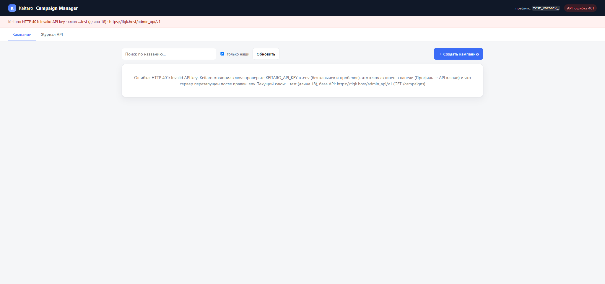

# Диагностика: `HTTP 401: Invalid API key`

Симптом: в интерфейсе/логах `Ошибка: HTTP 401: Invalid API key (GET /campaigns)`, при этом раньше плашка
писала «API подключён». Плашка проверяла только «ключ не пустой», а не «Keitaro его принимает» — теперь
она делает реальный запрос, поэтому показывает настоящий статус: `API: ok` / `API: ошибка 401` /
`API: не настроен`, и под шапкой появляется красная полоса с текстом ошибки и подсказкой.



## Что проверить по порядку

1. **В `.env` настоящий ключ, а не пример.**
   ```bash
   grep KEITARO_API_KEY .env
   ```
   Если там `put-your-api-key-here` — это и есть причина 401. Ключ берётся в панели Keitaro:
   `Профиль → API ключи` (значение из колонки `Key`, не `id`).
2. **Ключ без кавычек, пробелов и переносов.** `KEITARO_API_KEY="4bbb…"` или значение, скопированное
   с хвостовым пробелом, Keitaro не примет. Приложение теперь само срезает кавычки/пробелы, но лучше
   хранить чистое значение.
3. **Сервер перезапущен после правки `.env`.** Настройки читаются один раз при старте; `--reload`
   не перечитывает `.env`. Остановите `uvicorn` (Ctrl+C) и запустите снова.
4. **`KEITARO_BASE_URL` — именно `https://tlgk.host/admin_api/v1`.** Другой хост/путь даст 404 или 401.
5. **Ключ активен и от того аккаунта.** В панели `Профиль → API ключи` у ключа не должно быть статуса
   «disabled», и он должен быть выдан в этом аккаунте (в общем тестовом аккаунте ключи уже ротировали).
6. **VPN включён.** Без VPN `tlgk.host` отвечает 403 (или запрос вообще не проходит) — это не про ключ.

## Быстрая проверка в обход приложения

```bash
KEY=<ваш ключ>
curl -s -o /dev/null -w '%{http_code}\n' -H "Api-Key: $KEY" \
  https://tlgk.host/admin_api/v1/campaigns?limit=1
```

* `200` — ключ рабочий, проблема в приложении (пункты 2–4);
* `401` — ключ неверный/отозван (пункт 1, 5);
* `403` — сеть/гео-блокировка (пункт 6).

## Что показывает само приложение

```bash
curl -s http://127.0.0.1:8000/api/health | python -m json.tool
```

| Поле | Смысл |
|---|---|
| `keitaro_ok` | `true` — ключ реально принят Keitaro (был выполнен `GET /campaigns?limit=1`) |
| `keitaro_error` | текст ошибки от Keitaro/сети, `null` если всё хорошо |
| `keitaro_status_code` | HTTP-код ответа Keitaro (например `401`) |
| `api_key_hint` | какой ключ загружен: последние 4 символа и длина (полный ключ не отдаётся) |
| `api_key_is_placeholder` | `true`, если в `.env` остался пример ключа |
| `keitaro_base_url` | фактический адрес Admin API |

При старте с «заглушкой» вместо ключа:

```json
{"keitaro_configured": false, "api_key_is_placeholder": true,
 "keitaro_ok": false,
 "keitaro_error": "В .env остался пример ключа. Вставьте настоящий KEITARO_API_KEY …"}
```

## Что изменилось в коде после этого разбора

* `GET /api/health` делает реальный авторизованный запрос, а не проверяет «строка не пустая»;
* `Settings.keitaro_configured` больше не считает ключом заглушки вида `put-your-api-key-here`;
* `Settings` срезает кавычки/пробелы вокруг ключа и `/` в конце `keitaro_base_url`;
* ответ 401 от Keitaro превращается в `400` с текстом-подсказкой (какой ключ загружен, куда смотреть);
* в UI: плашка-индикатор со статусом (клик — перепроверить), красная полоса с текстом ошибки,
  `title` с подсказкой о загруженном ключе;
* тесты: `tests/test_api.py` — 401, отсутствующий ключ, заглушка, текст подсказки.

# Диагностика: `TypeError: Router.__init__() got an unexpected keyword argument 'on_startup'`

Полный текст в консоли:

```
File "...\app\main.py", line 26, in <module>
    app = FastAPI(
TypeError: Router.__init__() got an unexpected keyword argument 'on_startup'
```

Причина не в коде приложения: запускается **глобальный Python**, в котором стоит несовместимая пара
`fastapi` + `starlette` (например `fastapi 0.115` и `starlette 1.7`; fastapi 0.115 требует starlette
0.37–0.38). В проекте для этого есть свой `.venv`.

Проверить, что подхватилось:

```powershell
python -c "import fastapi, starlette; print(fastapi.__version__, starlette.__version__)"
# плохо: 0.115.0 1.7.0        хорошо: 0.115.0 0.38.6
```

Запуск правильным интерпретатором:

```powershell
# вариант 1 — активировать venv
.\.venv\Scripts\Activate.ps1
python run.py

# вариант 2 — без активации
.\.venv\Scripts\python.exe -m uvicorn app.main:app --reload --port 8000

# вариант 3 — с проверкой окружения (понятное сообщение вместо Traceback)
.\.venv\Scripts\python.exe run.py
```

`python run.py` проверяет версии `fastapi`/`starlette` и, если окружение неподходящее, печатает:

```
Запуск отменён:
  - starlette 1.7.0 несовместим с fastapi 0.115.0 (нужен starlette 0.37–0.38).
    Скорее всего запускается глобальный Python, а не .venv.
```

Предупреждение `StarletteDeprecationWarning: 'HTTP_422_UNPROCESSABLE_ENTITY' is deprecated` —
тоже следствие глобального starlette 1.x; в `.venv` его нет.
